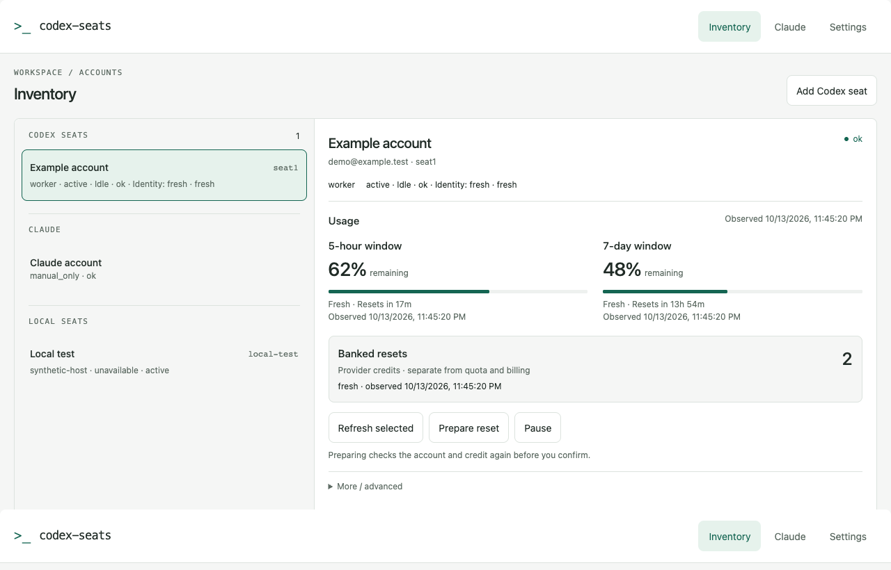

# codex-seats

> A little air traffic control for your coding agents. 🛫

Keep your Codex accounts, Claude usage, and local workers on one board.
Hand off a bounded task, let the controller find available capacity, and get
back a receipt with the changes and test evidence. You stay in charge of what
gets applied.



*The screenshot uses example data only.*

## What you get

- **One dashboard:** Codex seats, Claude, local workers, quota windows, reset
  times, and the freshness of each observation.
- **Workers that bring receipts:** isolated Git worktrees, durable results, and
  ChangeSets you can inspect before applying.
- **Reviews your way:** off by default; choose a single review or an independent
  Codex + Claude cross-review in Settings.
- **Banked resets on your terms:** track provider credits and redeem one manually
  through an exact preview and confirmation.
- **Room for local and Remote workflows:** opt-in local hosts/Qwen workers,
  shared head attachment, and completion wakes for compatible Remote sessions.

## Get aboard

The operational runner uses **macOS LaunchAgents**. Python tooling and portable
tests also run on Linux. You'll need **Python 3.11+, Git, uv**, and the Codex or
Claude CLIs you plan to use.

Clone this repository, then prepare a checkout-local development environment:

```sh
UV_PROJECT_ENVIRONMENT=.venv-dev uv sync --extra dev
.venv-dev/bin/codex-seat --version
```

For operational use, follow the
[immutable-release bootstrap guide](docs/immutable-release-activation.md).
It sets up the runtime, stable commands, and dispatch runner. A wheel or editable
install is useful for development and portable tooling; the Git bootstrap is
required for the macOS runner.

A new installation starts with an empty seat registry. In a trusted terminal,
add an account and complete its provider sign-in:

```sh
codex-seat dash --manage
codex-seat seats doctor --all
codex-seat ui
```

Keep the launching terminal open while using the browser. From the source
development environment, launch it with `.venv-dev/bin/codex-seat ui`.
The browser manages inventory and settings; provider sign-in stays in the
terminal manager. The [manager guide](docs/terminal-seat-manager.md) covers both.

## Your first handoff

Register a Git project and open a head:

```sh
codex-seat projects add example /path/to/git-project
codex-seat head codex --cd /path/to/git-project
```

From that head, hand over a bounded task:

```sh
codex-seat delegate "Fix the parser edge case and run focused tests"
codex-seat changeset inspect <job-id> --patch
codex-seat changeset apply <job-id>
```

`delegate` returns the job's receipt. Read the diff, tests, and warnings before
applying it. For independent background tasks, use `delegate --detach`, retain
the job IDs, and call `codex-seat await <job-id>...` once for completion.
`codex-seat head claude --cd REPO` uses the same delegation path.

## The knobs are in Settings

| Area | Choices |
| --- | --- |
| Reviews | Off, advisory, or blocking; single or cross-review |
| Delegation | Auto, always, or manual; inline task time threshold |
| Head access | Safe or full access; optional head worker fallback |
| Appearance | System/light/dark theme, comfortable/compact density, teal/indigo accent |
| Claude account | Provider mode, configured tier, headroom, and active usage refresh |

Automatic reviews are **off by default**. Review mode applies to goal supervision;
`delegate`, `await`, and ChangeSet application do not trigger reviews themselves.
Use `codex-seat review --strategy single` or `--strategy cross` when you want an
explicit review. Goal specs can also opt out with `review: "none"`.

Banked credits are tracked separately from normal quota resets and billing.
Preparing a reset spends nothing; confirming it allows one provider consume
attempt. An uncertain outcome is recorded without an automatic retry.
Codex usage comes from structured account refreshes. Claude uses passive
statusline/session observations and an optional bounded `/usage` refresh.
Stale observations are excluded from worker admission.

The current settings format is **schema 3**, with explicit stable `seatN` IDs.
Older formats are rejected. Start from the
[sanitized settings example](templates/settings.example.json), and change live
settings through the manager's preview and confirmation flow.

## A few ground rules

Run this against **trusted development code**. Restricted workers have scoped
access; trusted development workers, goal acceptance commands, and custom review
commands run as the same OS account. Their minimal environment excludes inherited
credentials, but it does not isolate the filesystem.

The contained Codex head mode is `--safe`. It requires a valid
`[permissions.head]` filesystem profile and fails closed if that profile is
missing. Seat management and settings changes require a trusted human terminal.
Existing installed hooks and live jobs are not removed by a source upgrade;
follow the activation guide when changing an installed release.

## Tinker responsibly

```sh
.venv-dev/bin/python -m pytest tests -q
.venv-dev/bin/python -m ruff check .
.venv-dev/bin/python scripts/check_subprocess_policy.py
.venv-dev/bin/python scripts/check_tracked_files.py
.venv-dev/bin/python scripts/check_likely_secrets.py
```

Keep contributions small and fixtures synthetic. Credentials, runtime state,
provider logs, and screenshots of live accounts stay out of the repository.
See [CONTRIBUTING.md](CONTRIBUTING.md) and [SECURITY.md](SECURITY.md).

## Further reading

- [Terminal and browser manager](docs/terminal-seat-manager.md)
- [Dual-head orchestration](docs/dual-head.md)
- [Local hosts and seats](docs/local-seats.md)
- [Trusted development workers](docs/trusted-development-workers.md)
- [Immutable releases and bootstrap](docs/immutable-release-activation.md)
- [Remote completion wakes](docs/remote-head-wake.md)
- [Packaging and CI](docs/packaging-ci.md)

Released under the [MIT license](LICENSE). Happy handoffs.
